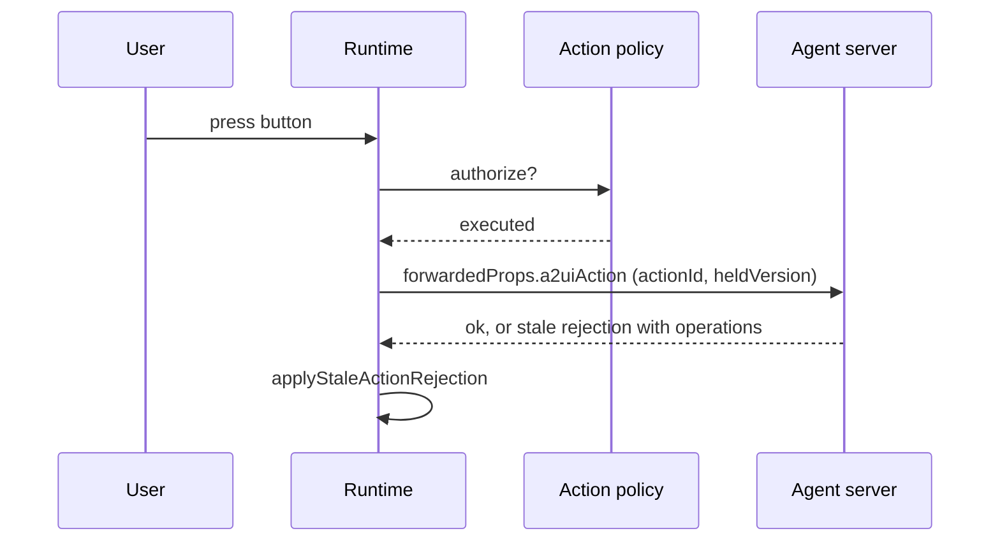

# Every interaction carries an id a server can trust

When a user presses a button on an agent-generated surface, the runtime asks your
action policy first. Only an action the policy **executed** leaves the runtime,
through `onActionEnvelope`. A denied action never does.



## The envelope

Put `envelope.forwardedProps` into the next AG-UI run input:

```json
{
  "a2uiAction": {
    "userAction": {
      "name": "save",
      "surfaceId": "order-review",
      "sourceComponentId": "save-button",
      "timestamp": "2026-10-28T12:00:00.000Z",
      "context": {}
    },
    "actionId": "01a1828e-cdf8-7204-9517-4a7080fc09d9",
    "heldVersion": { "epoch": 0, "version": 3 },
    "dataModel": { "version": "v0.9.1", "surfaces": { "order-review": {} } }
  }
}
```

| Field | Meaning |
| --- | --- |
| `userAction` | The A2UI action exactly as the renderer produced it. It is never modified |
| `actionId` | A globally unique UUIDv7 minted once per interaction. Two tabs, or one tab after a reload, never share one. A server uses it to make handling idempotent |
| `heldVersion` | The version the surface held when the action fired, so a server can tell a stale action from a current one. Absent for a surface with no versioned state |
| `dataModel` | Present only when the surface sets `sendDataModel` |

The runtime does not arbitrate duplicates. De-duplicating by `actionId` is the
server's job, which is why the id is stable across retries.

```ts
const runtime = createPrometheusA2uiRuntime({
  actionPolicy,
  onActionEnvelope: (envelope) => {
    sendRunInput({ forwardedProps: envelope.forwardedProps });
  },
});
```

## Two different ids

A v1.0 `wantResponse` action can also carry an `actionId`. That is a
**correlation** id, shaped `surface:component:n`, unique only within one runtime
instance, that matches an `actionResponse` to its action. It is unchanged. The
envelope's `actionId` is an **idempotency** id and is global. They do different
jobs. Do not use one for the other.

## Retry

```ts
const resent = runtime.retryAction("01a1828e-cdf8-7204-9517-4a7080fc09d9");
```

`retryAction` resends the original envelope under the **same** id. The runtime
owns retry because a host that resent on its own would mint a new id and defeat
idempotency. The resent envelope keeps the `heldVersion` and data model from when
the action fired. It returns `false` for an unknown id (the last 100 envelopes
are retained) or when no handler is installed.

## Stale-action rejection

A server that sees an action built on an old version can reject it and return
what the client is missing. Pass that to `applyStaleActionRejection`:

```json
{
  "actionId": "01a1828e-cdf8-7204-9517-4a7080fc09d9",
  "a2ui_operations": [],
  "surfaceVersions": { "order-review": { "epoch": 0, "version": 5 } }
}
```

`a2ui_operations` are the operations since the version the client held, and
`surfaceVersions` are the versions they bring each surface to. They go through the
same ordering and limits as any activity, so a repeated rejection changes
nothing. A rejection that carries no operations cannot repair the surface, so the
runtime calls `onResyncNeeded` with reason `stale-action`.

## Building run input yourself

`buildA2uiForwardedProps` is exported from both the root and the headless entry,
so a server or a non-React client can produce the same shapes.

```ts
import { buildA2uiForwardedProps } from "@prometheus-ags/a2ui-react";

const forwardedProps = buildA2uiForwardedProps({
  resync: { held: runtime.getHeldVersions() },
});
```
