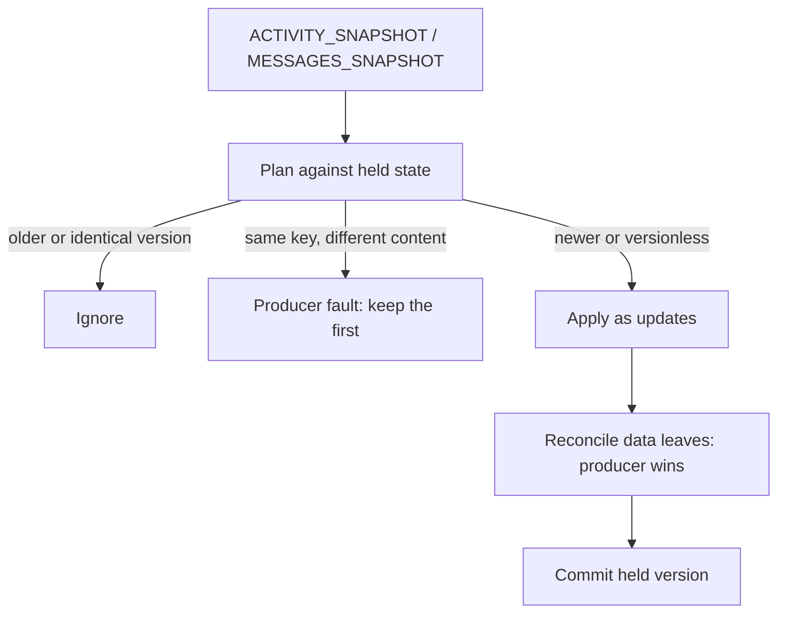

# Redelivery is normal, so delivery is idempotent

AG-UI clients see the same activity more than once. A stream reconnects and
replays. A `MESSAGES_SNAPSHOT` restates a whole thread. Two streams carry the
same message. AG-UI 1.0 defines no version, sequence or idempotency field on
activity events, so the runtime cannot rely on the transport to say "you have
seen this".

Before 4.3.0 every snapshot deleted the surfaces its message had named and
replayed that one message. A redelivered activity therefore rolled a surface
back and threw away typed input. The runtime now **reconciles instead of
replays**.



## The rules

**A surface is deleted only by an explicit `deleteSurface`.** A `replace: true`
snapshot restates what the producer says; it is applied to the held surface as
updates. It never deletes a surface and never recreates one. Components the
restatement leaves out stay, because the official processor never removes a
component the producer stops mentioning.

**Typed input survives.** The runtime remembers the last value the producer wrote
at each data leaf and writes only leaves whose producer value changed. An
unchanged value cannot overwrite what the user typed. If the producer changes a
leaf the user also changed, the **producer wins**, and `onConflict` reports it so
you can surface it. A leaf the producer wrote earlier and no longer states is
removed.

**A deleted surface stays deleted.** A redelivered create or update at or below
the version that deleted it cannot revive it. Only versioned deletions are
remembered, bounded by `maxTombstones`.

**A message absent from a `MESSAGES_SNAPSHOT` leaves its surfaces alone.** The
snapshot is the complete set of activity messages. A tracked message it omits is
forgotten as a message only; its surfaces stay. A snapshot with no activity
messages is not handled.

## Ordering is optional and per surface

Because AG-UI has no version field, a producer that wants ordering carries one in
the activity's own content:

```json
{
  "type": "ACTIVITY_SNAPSHOT",
  "messageId": "m1",
  "activityType": "a2ui-surface",
  "replace": true,
  "content": {
    "surfaceVersions": { "order-review": { "epoch": 2, "version": 7 } },
    "a2ui_operations": []
  }
}
```

| Field | Meaning |
| --- | --- |
| `version` | An integer that orders one surface's activities. An older version is ignored, an identical one is ignored, a newer one is applied |
| `epoch` | An integer the producer raises on every restart. A restarted producer that numbers from 1 again is not mistaken for an old one. A missing epoch means `0` |

One activity can touch several surfaces and each is decided on its own.

- **Same key, different content** (`version-conflict`) is a producer fault: the
  first is kept, the second ignored, and the two are never merged.
- **A producer that sends no versions** is protected only against an identical
  redelivery of the same message. Out-of-order delivery of versionless activities
  is not detected, so version your activities if order matters.
- **Restating `createSurface` for a held surface** applies its inline components
  and data model as updates. If it changes the catalog, theme or `sendDataModel`,
  that surface's operations in the activity are ignored and a
  `surface-config-mismatch` fault is reported.

## Reading what the runtime did

| Callback | Called when |
| --- | --- |
| `onConflict` | the producer changed a data leaf the user had also changed |
| `onProducerFault` | a version conflict, a config mismatch, a limit, or a refused batch |
| `onResyncNeeded` | the runtime needs the producer to restate state, see [Deltas and resync](deltas-and-resync.md) |

```ts
const runtime = createPrometheusA2uiRuntime({
  onConflict: ({ surfaceId, path, producerValue, localValue }) => {
    telemetry.count("a2ui.conflict", { surfaceId, path });
  },
});
```

## Upgrading from 4.2.x

If you relied on a `replace: true` restatement to remove a surface or its
components, send `deleteSurface` for the surface you want gone. Components a
producer stops mentioning persist in a held surface. This is the one deliberate
behavior change in 4.3.0.

Only `processAgUiEvent` tracks and reconciles. Messages passed straight to
`processMessages` are applied as before and are neither versioned nor
deduplicated. Each `processMessages` call is still one transaction: the whole
batch is preflighted against a shadow processor, so a later error cannot commit
an earlier message.
