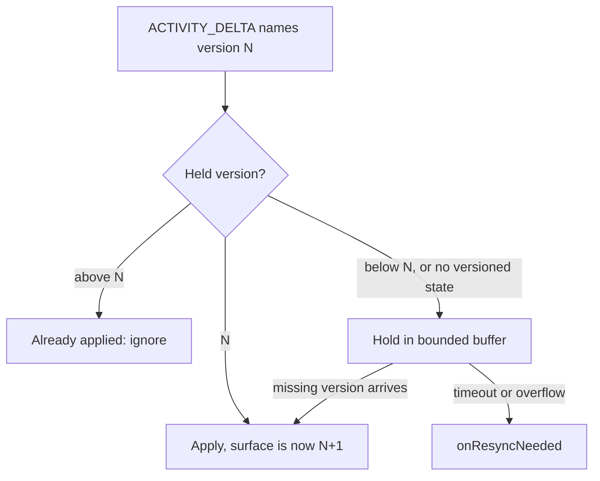

# Update a surface without resending it

A producer can change a long-lived surface with a small `ACTIVITY_DELTA` instead
of a full snapshot. A delta applies on top of the version it names and produces
the next one.

```json
{
  "type": "ACTIVITY_DELTA",
  "messageId": "m1",
  "activityType": "a2ui-surface",
  "patch": [
    { "op": "test", "path": "/surfaceVersions/order-review/version", "value": 3 },
    {
      "op": "add",
      "path": "/a2ui_operations/-",
      "value": { "version": "v0.9.1", "updateComponents": { "surfaceId": "order-review", "components": [] } }
    }
  ]
}
```

## A deliberately small subset

Only two JSON Patch operations are accepted:

- `add` to `/a2ui_operations/-`, which appends an A2UI operation;
- `test` on `/surfaceVersions/<surfaceId>/version`, and optionally
  `/surfaceVersions/<surfaceId>/epoch`.

Anything else is rejected with `invalid-message`. A delta that touches a surface
without naming its version is rejected, because it cannot be ordered. `remove` is
rejected because the official processor cannot remove a component. Without an
`epoch` test, the held epoch is assumed.

## What happens to a delta



- **In order:** applied. The surface moves to the next version.
- **Already applied or behind:** ignored.
- **Ahead of what is held, or for a surface with no versioned state:** held in a
  bounded buffer (`maxBufferedDeltas`, `bufferTimeoutMs`). When the missing
  version arrives, the held deltas apply in order. If it never arrives, or the
  buffer overflows, the runtime asks for a resync.
- **A delta touching several surfaces** waits as a whole until every surface is in
  order.

## Resync

`onResyncNeeded(request)` fires when:

| `request.reason` | Meaning |
| --- | --- |
| `gap` | a delta waited too long for the version it builds on |
| `missing-surface` | a delta named a surface the runtime holds no state for |
| `buffer-overflow` | too many deltas were waiting |
| `refused` | the runtime refused a batch the producer had accepted (a disallowed component, a topology error, a limit) |
| `stale-action` | the server rejected an action as stale and returned nothing to repair it |

AG-UI has no resync event, so you send the request upstream inside
`forwardedProps` on the next run input:

```ts
import { buildA2uiForwardedProps, createPrometheusA2uiRuntime } from "@prometheus-ags/a2ui-react";

const runtime = createPrometheusA2uiRuntime({
  onResyncNeeded: (request) => {
    sendRunInput({
      forwardedProps: buildA2uiForwardedProps({ resync: { held: request.held } }),
    });
  },
});

runtime.getHeldVersions(); // { "order-review": { epoch: 0, version: 3 } }
runtime.getResyncForwardedProps(); // the same, shaped for forwardedProps
```

The producer reads `forwardedProps.a2uiResync.held`, sees exactly which
`(epoch, version)` the client holds per surface, and answers with the operations
since then, or a fresh snapshot.

`dispose()` clears the buffer and every pending timer.
