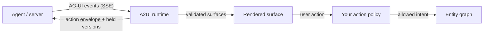

# Agents propose interfaces. Your application keeps the authority.

`@prometheus-ags/a2ui-react` renders interfaces that an agent describes, and it
connects that interface to the entity graph without ever giving the agent
control of it. This section explains the two protocols involved, what the
package guarantees when messages are delivered over AG-UI, and how to wire it up.

## Two protocols, two jobs

| Protocol | Job | What it carries |
| --- | --- | --- |
| **A2UI** | Describe an interface from a catalog of approved components | Surfaces: components, a data model, and the actions a user can take |
| **AG-UI** | Move agent events to the client | Runs, messages, tool calls, and activities. An A2UI surface rides inside an *activity* |

A2UI is the picture; AG-UI is the delivery truck. They are independent, and the
package keeps them apart: the package root is the official A2UI surface, and
`@prometheus-ags/a2ui-react/ag-ui` holds the older AG-UI chat components.



## What the package guarantees

- **Validity is not authority.** A surface can be perfectly valid A2UI and still
  be refused. Components come from an allowlist, and every action passes your
  default-deny policy, with optional human approval. See
  [Limits and security](limits-and-security.md).
- **Redelivery is safe.** Reconnects, thread snapshots and duplicate streams
  never roll a surface back or erase what the user typed. See
  [AG-UI delivery](agui-delivery.md).
- **Long-lived surfaces update incrementally.** Versioned deltas apply in order,
  wait when something is missing, and ask for a resync when the gap does not
  close. See [Deltas and resync](deltas-and-resync.md).
- **Actions are idempotent.** Each interaction carries a globally unique id, so a
  server can safely handle a retry. See [Actions](actions.md).
- **Untrusted input is bounded.** Resource limits are on by default and reject a
  whole call rather than truncating it. See [Limits and security](limits-and-security.md).
- **It runs without a browser.** A headless entry applies the same validation on a
  server and can export a surface as messages. See
  [Headless runtime and export](headless-and-export.md).

## Pick your entry point

| You want to | Import |
| --- | --- |
| Render surfaces in React | `@prometheus-ags/a2ui-react` |
| Validate or mirror agent output on a server, or export a surface | `@prometheus-ags/a2ui-react/headless` |
| Keep the pre-3.0 AG-UI chat components | `@prometheus-ags/a2ui-react/ag-ui` |

## Version axes

These numbers are related but are not interchangeable:

| Axis | Selected target |
| --- | --- |
| Public A2UI input | `v1.0` release candidate and `v0.9.1` |
| Official renderer engine | `v0.9.1` compatibility boundary |
| `@a2ui/react` / `@a2ui/web_core` | `0.12.0` |
| `@a2ui/markdown-it` | `0.2.0` |
| AG-UI | `@ag-ui/core` peer range `>=0.0.59 <0.1.0 \|\| ^1.0.0`, developed against `1.0.3` |

The published A2UI packages do not expose a v1 renderer yet. The runtime
validates the v1.0 release-candidate envelope, decomposes its embedded surface
into the official v0.9.1 processor, and keeps v1-only action metadata at the
boundary. It does not claim an upstream v1 renderer.

## Quick start

```tsx
import {
  PrometheusA2uiProvider,
  PrometheusA2uiSurface,
  createPrometheusA2uiRuntime,
} from "@prometheus-ags/a2ui-react";

const runtime = createPrometheusA2uiRuntime({
  onProducerFault: (fault) => reportToTelemetry(fault),
  onConflict: (conflict) => reportToTelemetry(conflict),
});

// Feed every AG-UI event from your transport to the runtime.
agUiStream.on("event", (event) => runtime.processAgUiEvent(event));

export function AgentSurface() {
  return (
    <PrometheusA2uiProvider runtime={runtime}>
      <PrometheusA2uiSurface surfaceId="order-review" />
    </PrometheusA2uiProvider>
  );
}
```

The runtime is application-owned. Create it once, pass it to the provider, and
call `runtime.dispose()` when it is no longer needed.

## Try it

The [`agui-activity-lab`](../examples/agui-activity-lab.md) example is a real AG-UI
producer and a React consumer you can run locally to replay, reorder and
overload the runtime and watch what it does.

## Where the reference lives

- Package reference: `packages/a2ui-react/README.md`
- Wire contract and evidence boundary: `release/a2ui-protocol-bridge.md`
- Policy-controlled A2A and A2UI tutorial: [Agentic A2UI](../examples/agentic-a2ui.md)
